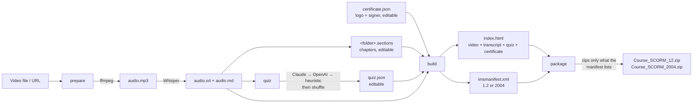

# scorm-scorcher: Project Summary

*As of 2026-11-24 · branch `dev`*

## What it does

`scorm-scorcher` is a command-line tool that turns a training video into a
**SCORM package**: a zip file you upload to a learning management system
(LMS) such as SCORM Cloud, Moodle, Cornerstone or Docebo.

One command produces a single course page with:

- **The video**, with a synced transcript (auto-scroll on/off) and clickable
  chapter links.
- **A watch-first gate.** On the first viewing, learners can rewind but can't
  skip ahead, and speed is capped at 2x. The quiz stays locked until the video
  has played to the end.
- **A quiz** that appears when the video ends. It is written by Claude (or
  OpenAI, or a built-in fallback), with answers shuffled, immediate feedback,
  and unlimited retakes. 80% passes.
- **A certificate** for learners who pass: classic diploma style, your logo, a
  typed signer name and title, and the learner's name from the LMS (or typed by
  the learner). It prints on one landscape page.
- **LMS tracking**: completion, pass/fail, score, each quiz answer, and resume
  where the learner left off. It works with both SCORM 1.2 and SCORM 2004.

## Where it stands

| Area | Status |
|---|---|
| Core pipeline (prepare → quiz → build → package) | Working; used on a real 13-minute course (AI Basics) |
| Watch-first quiz gate | Done; confirmed working by Rio |
| Auto-scroll transcript, shuffled answers | Done (`1e51e19`) |
| Classic certificate with logo and signer | Done (`da5b23e`). The default logo comes from the `brand/` folder (not in git) |
| Automated tests | 133 pytest tests pass. Tests never see real API keys or the real logo (`tests/conftest.py`) |
| Browser tests | 30 headless-Chrome checks pass against a simulated SCORM 2004 LMS (session scratchpad, not in the repo) |
| SCORM Cloud | Rio is testing. The **1.2 package has not been browser-tested yet** |
| GitHub | `RadioUFHM/scorm-scorcher`. `dev` is pushed |
| `main` | Behind `dev`; a dev → main PR has not been opened yet |

### Recent work (newest first, all on `dev`)

1. `da5b23e`: classic certificate, `--logo / --signer-name / --signer-title`, and a typed-name fallback
2. `1e51e19`: transcript auto-scroll is back; answer options are shuffled; only the current transcript line is highlighted
3. `f6a3baf`: quiz locked until the video is watched (one-page / one-SCO design); fixed SCORM 2004 resume (`cmi.exit = suspend`)
4. `5b42cc9`: the tool says which quiz generator it is using (so a missing API key is no longer silent)
5. `91aae63`: fixed Claude quizzes being cut off at 10 questions
6. Earlier: packaging allowlist, title escaping, SCORM 2004 manifest fixes, repo cleanup

### Open items

- **Confirm SCORM Cloud** for both zips: completion, pass/fail, score,
  interactions, resume, skip-ahead blocked, and learner name on the certificate.
- **Open a dev → main PR** when Rio is ready.
- Possible follow-ups (not started):
  - a built-in `preview` command, so `npx http-server` isn't needed
  - recording time spent (`cmi.session_time` is not set, so LMSs show 0 time)
  - the quiz model is hardcoded to `claude-haiku-4-5`
  - `anthropic` is an optional extra, not a base dependency
- Known limitations: the quiz is graded in the browser, so the answer key is in
  the page source. Treat it as a comprehension check, not a secure exam.

## How to use it

```bash
# ANTHROPIC_API_KEY is set in ~/.zshrc (see README), for Claude-written quizzes
# The certificate logo defaults to the one image in brand/ (e.g. brand/FCITlogo.png)

# All four steps in one go (--auto skips the edit pauses)
scorm-scorcher run --video "Input_Video/lesson.mp4" --output output_folder/lesson \
  --title "Lesson Title" --scorm both --auto \
  --signer-name "Rio Miner" --signer-title "Principal"

# Or step by step, editing in between
scorm-scorcher prepare --video … --output output_folder/lesson   # audio, transcript, chapters
scorm-scorcher quiz    --input output_folder/lesson --num-questions 10
#   edit lesson.sections (chapters) and quiz.json (questions) by hand
scorm-scorcher build   --video … --input output_folder/lesson --title "…"
scorm-scorcher package --input output_folder/lesson --title "…" --scorm both

# Preview locally (no LMS): the server must support range requests
cd output_folder/lesson && npx --yes http-server -p 8000
#   http://localhost:8000/          normal (quiz locked)
#   http://localhost:8000/?unlock   skip the gate (preview only)
```

## Architecture

### Pipeline



Files Rio edits between steps (`.sections`, `quiz.json`, `certificate.json`)
stay in the build folder and are **never packaged**. The packager zips only
what `imsmanifest.xml` lists, so work files (audio, transcripts, segments) can
never leak into a course.

### Python modules (`src/scorm_scorcher/`)

| Module | Role |
|---|---|
| `cli.py` | Click commands: `prepare`, `quiz`, `build`, `package`, `run`. Resolves the video mode, wires the steps together, and reports errors in plain English |
| `video_processing.py` | ffmpeg: input checks, audio extraction, optional segmenting, downloading for embed mode |
| `transcription.py` | Local Whisper (`base` model) → `.srt` |
| `transcript.py` | SRT parsing, the markdown transcript, and reading/writing/auto-generating `.sections` |
| `quiz_generation.py` | Claude (preferred) → OpenAI → word-blanking fallback; answer shuffling; JSON/XLSX export |
| `builder.py` | Renders `index.html` from templates (one-pass `{{PLACEHOLDER}}` fill, script-safe JSON); certificate settings and logo; SCORM 1.2/2004 manifest |
| `scorm_packager.py` | Reads the manifest and zips exactly the listed files |

### The course page (`templates/`)

| File | Role |
|---|---|
| `player_template.html` | The whole learner experience: video player (HTML5, signed URL, or YouTube), transcript and auto-scroll, chapter links with locks, first-viewing gate, quiz engine, results, and saving/resuming progress |
| `certificate_partial.html` | Certificate layout, print styles, and the typed-name form; inserted into the page at build time |
| `scorm-shim.js` | One small layer over both SCORM APIs: finds the LMS, maps 1.2 and 2004 field names, and saves progress and sets `cmi.exit` before the session closes |
| `branding.css` | Shared base styles |

**One page, one SCO.** The video and quiz live in the same `index.html`, so
the LMS sees one activity with one result, and the quiz can't be opened from
the LMS menu before the video is watched. The earlier two-page design is
preserved at tag `archive/two-page-quiz-2026-11-16`.

### Tracking model (what the LMS receives)

| Event | SCORM data |
|---|---|
| Launch (not yet passed) | `completion_status = incomplete` (2004) / `lesson_status = incomplete` (1.2) |
| Every ~10 s and on exit | `suspend_data` = `{v:2, pos, maxw, watched, quiz:{cur, ans}, name}` |
| Leaving before passing | `cmi.exit = suspend`, so the next launch resumes |
| Each quiz answer | `cmi.interactions.N`: id, learner response, correct pattern, result |
| Quiz finished | Score (0–100) and passed/failed (80% mastery). A retake never lowers a recorded pass |
| No quiz in the course | Marked `completed` once the video has been watched |

### Video delivery modes

- **embed** (the default for local files): the MP4 ships inside the zip, with no outside calls.
- **url**: a signed or hosted URL is referenced and never copied. Combined with
  `--video-expiry`, it shows a branded "license expired" panel and blocks the
  certificate after that date.
- **youtube**: marketing and demo use only; requires `--allow-youtube`.

## Repo and branches

- Repo: `https://github.com/RadioUFHM/scorm-scorcher` (moved from `fcitradecraft` on 2026-11-03)
- `main`: the stable version; changes only through PRs. `dev`: all new work.
- Archive tags: `archive/legacy-root-files-2026-11-09`, `archive/two-page-quiz-2026-11-16`
- Archive branch: `archive/dev-2025-08-29` (the old 2025 `dev`)
- Tests: `/opt/anaconda3/bin/python3 -m pytest` (the default `python3` on this
  Mac may belong to another project's venv)
